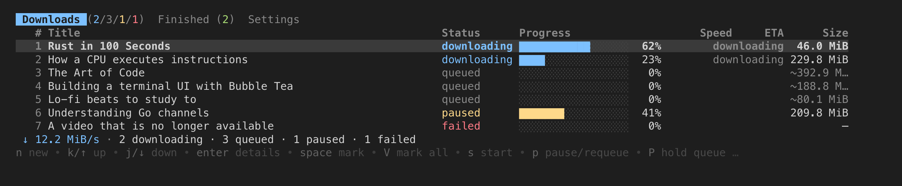

# vidl

A terminal UI for downloading videos, built with Go and
[Bubble Tea](https://github.com/charmbracelet/bubbletea) on top of
[yt-dlp](https://github.com/yt-dlp/yt-dlp).

vidl manages a download queue for you: paste a URL, pick a format and
resolution, and it downloads in the background with progress, speed and ETA
for every item. The queue and history survive restarts, and interrupted
downloads resume where they stopped.



> **Status:** feature complete for a first release; everything ticked on
> the [Roadmap](docs/roadmap.md) works. The UI is tested manually on macOS.

## Documentation

- [Usage](docs/usage.md): commands, the new-download dialog, search, filters, marking and the status line
- [Keybindings](docs/keybindings.md): every key in the Downloads, Finished and Settings tabs
- [Configuration](docs/configuration.md): `config.toml` settings, notifications, formats and the files vidl keeps
- [How it works](docs/how-it-works.md): how vidl drives yt-dlp
- [Troubleshooting](docs/troubleshooting.md): missing formats, HTTP 403, bot checks and other common errors
- [Development](docs/development.md): building, testing, `make` targets, project layout and releasing
- [Roadmap](docs/roadmap.md): what's done
- [Implementation plan](docs/PLAN.md): architecture, conventions and lessons learned

## Features

- **New-download dialog**: paste a URL (prefilled from the clipboard), see
  its title, uploader, duration and approximate size, pick a format and
  resolution, and queue it. Per download you can also download only a clip
  (start and end time), use a different filename template, turn embedded
  subtitles on or off, or keep sponsor segments, and add it queued, paused or
  started right away. Playlists open a checklist to leave out entries before queueing;
  pasting several URLs at once queues them all with the default settings.
- **Duplicate warning**: adding a video that's already downloaded or still in
  the queue asks before adding it again; in playlists and pasted batches such
  videos start unchecked or are skipped, and `vidl add` skips them.
- **Download queue** with a configurable number of concurrent downloads.
  Queued items start automatically, top to bottom.
- **Per-download progress**: percentage, speed and ETA, combined across the
  separate video and audio streams yt-dlp fetches before merging.
- **Pause, resume, cancel and retry.** Pausing keeps partial files so the
  download resumes; `p` on a paused download puts it back in the queue to
  wait for a free slot, while `s` resumes it at once. Cancelling deletes
  partial files. `R` on a finished download downloads it again and
  replaces the file.
- **Hold the queue** with `P`: running downloads finish and nothing new
  starts, whether queued, added or sent with `vidl add`. `s` still starts a
  download, and `P` again lifts the hold. **Stop the queue** with `S`: it
  pauses every running download (partial files are kept) and holds the
  queue; `S` again resumes only the downloads the stop paused, so ones you
  paused yourself stay paused. A `⏸ HELD` or `⏸ STOPPED` badge at the right
  of the tab bar shows either state. Both last for the session.
- **Wait between downloads** with `W`: after a download ends (finished,
  failed, paused, cancelled or removed), the next queued one starts only once
  `wait_duration` (30s by default) has passed; each further end restarts the
  countdown. `s` still starts a download at once. A `⏱ 30s` badge in the tab
  bar shows the timer is on, and counts down while waiting (`⏱ 23s`,
  `⏱ 1:45`); a hold or stop freezes the countdown. The setting is saved.
- **Reordering**: move waiting downloads up and down the queue.
- **Finished history** of completed downloads: open a file or show it in
  its folder, and clear the history.
- **Search** to filter downloads and history by title or URL, and a status
  filter for the queue.
- **Status line** with the total speed and the number of downloads per
  status, and the overall progress in the terminal's window title.
- **Detail panel** for any download: source, format, clip, template and
  subtitle overrides, progress per stream, timestamps, output and partial
  files, errors, and yt-dlp's latest output
  for running or failed downloads.
- **Error view** (`i`) for a failed download: the full error and yt-dlp's
  output, full-screen and scrollable. Failed downloads keep their last 200
  output lines across restarts.
- **Desktop notifications** when a download finishes or fails. Downloads
  ending within about two seconds of each other share one notification.
- **`vidl add`** hands URLs to the running vidl from scripts or browser
  hooks, queued or (with `--paused`) paused. Only one vidl runs at a time;
  with none running, the URLs wait in the saved queue for the next start.
- **Persistence**: queue and history are saved on every change; downloads
  running when you quit are resumed on the next start.
- **Output formats**: mp4, mkv, webm (video) and mp3, m4a, opus (audio only),
  with a maximum resolution from 360p up to 2160p or best available.
- **yt-dlp options** exposed as settings: filename template, embedded
  subtitles, thumbnails and metadata, rate limit, cookies from your
  browser for private or age-restricted videos, and
  [SponsorBlock](https://sponsor.ajay.app/) to cut sponsor segments and
  other categories out of videos.
- **Vim-style navigation.**

## Requirements

- [yt-dlp](https://github.com/yt-dlp/yt-dlp) on your `PATH`, ideally a recent
  version (sites change often; update with `yt-dlp -U` or your package
  manager).
- [ffmpeg](https://ffmpeg.org) on your `PATH`, used to merge video and audio
  streams, extract audio and embed thumbnails/subtitles.
- [Go](https://go.dev/dl/) 1.27 or newer to build from source.
- macOS or Linux. Windows is supported but less tested.

vidl checks for yt-dlp and ffmpeg at startup and exits with an install hint
if either is missing. It also reads the yt-dlp version in the background and,
if that release is more than 60 days old, shows a toast with the update
commands. vidl never updates yt-dlp itself.

### Installing the dependencies

macOS (Homebrew):

```sh
brew install yt-dlp ffmpeg
```

Debian/Ubuntu (the distro's yt-dlp package is often outdated, so prefer
pipx):

```sh
sudo apt install ffmpeg pipx
pipx install yt-dlp
```

Arch Linux:

```sh
sudo pacman -S yt-dlp ffmpeg
```

Windows (winget):

```sh
winget install yt-dlp.yt-dlp Gyan.FFmpeg
```

YouTube additionally needs a JavaScript runtime (such as
[Deno](https://deno.com)) for yt-dlp to see every format; see
[Troubleshooting](docs/troubleshooting.md).

## Installation

With Homebrew (macOS and Linux; installs yt-dlp and ffmpeg too):

```sh
brew install chriha/vidl/vidl
```

Or download the archive for your platform from the
[releases page](https://github.com/chriha/vidl/releases), check it against
`checksums.txt`, unpack it and put `vidl` on your `PATH`:

```sh
shasum -a 256 -c checksums.txt --ignore-missing
tar -xzf vidl_*_darwin_arm64.tar.gz vidl
mv vidl /usr/local/bin/vidl
```

On macOS, a downloaded binary is quarantined by Gatekeeper; allow it with
`xattr -d com.apple.quarantine /usr/local/bin/vidl`.

Or install with Go:

```sh
go install github.com/chriha/vidl/cmd/vidl@latest
```

Or build from source:

```sh
git clone https://github.com/chriha/vidl.git
cd vidl
make install        # installs into $(go env GOPATH)/bin
```

For `go install` and `make install`, make sure `$(go env GOPATH)/bin` is on
your `PATH`. Alternatively, build into the project directory with
`make build` and run `./bin/vidl`.

To uninstall, run `make uninstall` and optionally remove the config directory
(see [Files](docs/configuration.md#files)).

## Quick start

```sh
vidl                        # open the UI
vidl <url> [<url>...]       # open the UI and queue the given URLs
vidl add <url> [<url>...]   # queue URLs in the running vidl
```

Press `n` to add a download, `enter` to queue it, `s`/`p`/`c` to start, pause
or cancel, `?` for the full key list and `q` to quit. See [Usage](docs/usage.md)
and [Keybindings](docs/keybindings.md) for the rest.

## License

[MIT](LICENSE)
